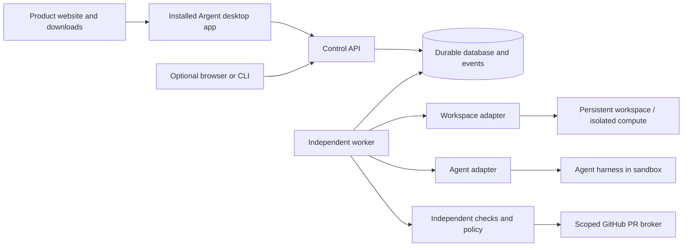
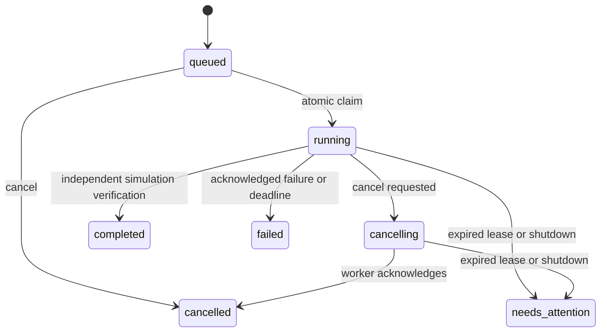

# Architecture

Status: M0 and the P1 local desktop prototype implemented; managed architecture
below is the proposed target.
No upstream fork, cloud deployment or paid resource is configured.

## Shape and boundaries

A modular monolith with separate API and worker processes. An installed desktop
application is the primary client; it reads state and sends commands without
owning execution. A public website distributes installers and documentation.
Browser access may be added as a secondary client. Keep authoritative execution
state outside suspendable workspace compute.

M0 implements the control API, durable SQLite store and independent worker with
local simulation adapters. P1 adds the installed desktop client and local download
page source. Real cloud workspaces, coding agents and the GitHub PR broker remain
M1 targets. Verification currently checks only a simulation artifact.

## Persistence and execution

M0 stores workspaces, runs and ordered events in SQLite with WAL, full synchronous
commits, foreign keys and indexed run/event lookups. `BEGIN IMMEDIATE` serializes
claims and state transitions across processes. A partial unique index permits
one active run per workspace. An application guard also blocks uncertain runs.
Run insertion and its queue event commit together; completion and verification
evidence commit together. There is no separate in-memory task queue.

A claim persists a random fencing token, lease expiry and absolute execution
deadline before invoking an adapter. Heartbeats extend a live lease only. Every
worker write validates ownership. The API omits fencing tokens from responses.
Idempotency keys deduplicate submission and reject changed payloads.

An unknown outcome is never retried automatically. `needs_attention` blocks
new work and lifecycle changes for the workspace. P1 adds audited abandonment
for simulated runs only; real-provider reconciliation remains future work.
Reconnect reads run state and events after an
ordered cursor; it does not dispatch work. No exactly-once external-effects
guarantee is claimed. A database token cannot fence a Git push or cloud process.

The worker must remain running for execution and lease reconciliation. API
availability and worker availability are independent; neither survives shutting
down this local computer. Cloud-hosted workers are required for laptop independence.
The scripted adapter is cooperative and bounded. Arbitrary blocking code must
never run inside the control-plane process; future adapters control isolated
processes with provider-enforced resource/deadline limits.

## Desktop delivery

P1 uses Electron 45.2.3 with a sandboxed, context-isolated renderer and no Node
integration. Packaged assets load through an allowlisted custom protocol and CSP.
The preload exposes named operations only; the main process validates the exact
main-frame sender and translates operations to authenticated loopback requests.
Only the service/main process can read the private operator credential.

The desktop's detached service cohosts the HTTP API and bounded worker loop for
this single-host prototype. The original separate API/worker mode remains tested.
A separate SQLite ownership database holds an exclusive OS-backed lock while the
service runs; process death releases it without relying on PID liveness. API and
worker data use the main WAL database. The desktop reconnects to a service by
private instance identity and health challenge, not just an open port.

The first usable prototype must launch as a local desktop application, with
workspace/task controls, activity history and verification details. The desktop
shell must keep privileged filesystem/process APIs and credentials outside its
renderer, use a narrow validated bridge, and load only trusted packaged content.
It connects to a persistent local service or a configured remote control plane.
Window close, application exit and explicit execution-service shutdown are
separate lifecycle operations.

Provide a packaged macOS prototype first in this development environment. Track
Windows/Linux packaging separately. Public distribution requires signed/notarized
artifacts where applicable, versioned downloads, checksums and a verified update
path. An unsigned local build must not be represented as a public-ready installer.
The website must describe available builds truthfully and never offer fabricated
download links. No publication or paid signing account is implied by development.

## Internal lifecycle simulation

`Store.lifecycle` shares M0's SQLite connection through a separate
`LifecycleStore` module. Dedicated lifecycle workspace/operation/event tables
keep cloud lifecycle states distinct from metadata-only local stop/start.
Enrollment and M0 submission/claims serialize through the same database;
enrolled workspaces cannot execute via the local adapter, even when ready.

The internal simulation-only worker claims operations, records dispatch intent,
requires quiescence before pause and bounds calls with an absolute deadline and
fenced heartbeat. Expiry and ambiguous outcomes block dispatch. Read-only
provider inspection may settle the original operation if identity and target
state match; an absent create marker remains inconclusive. Delete requires
confirmed absence and retains its provider ID in an audit tombstone.

This harness is not wired into the public API, desktop bridge or service worker
loop. It has no live GitHub credentials, real checkout, persistence manifest,
real provider, resource policy or full cleanup inventory. Its simulation-only
adapter contract must not be expanded for real execution before those boundaries
are implemented and verified. See [spec 0007](docs/specs/0007-cloud-workspace-lifecycle.md).

## Internal repository access simulation

`Store.repositories` adds a separate repository operation/event queue on the same
SQLite connection. Bootstrap binds a ready lifecycle workspace and provider ID;
its enrollment and lifecycle requests serialize under the same write lock.
Pending or uncertain bootstrap blocks pause/delete. At most one non-failed
bootstrap per workspace is allowed; even a successful checkout is not repeated
under a new request key. Clean pre-mint failures permit a fresh request.

The simulation-only worker asks a trusted server-side authority to validate the
operator/repository/ref and return numeric repository/installation IDs. Client
input cannot select the installation or permissions. Each new operation checks
authority before requesting a single-repository Contents-read token. Returned
scope/expiry is validated before resolving a full commit SHA. Checkout receives
a credential-free fixed plan and a separate ephemeral credential argument; a
separate inspection call must match the plan with hooks/submodules/LFS disabled.

Intent precedes mint/checkout dispatch; leases fence state writes. The worker
attempts bounded token revocation and channel clearing on success or failure.
Success requires checkout verification and both cleanup acknowledgments.
Exceptions are never persisted. Unknown outcomes, expired ownership and cleanup
failure retain `needs_attention` plus token/channel obligations; reconnect only
reads. This is a separate bootstrap status, not a new lifecycle-ready guarantee.

An internal, simulation-only recovery path accepts the original authenticated
operator and performs bounded, read-only independent inspection. Only fresh,
identity-bound confirmation of settled effects, revoked/absent credentials,
cleared/absent channels and no partial checkout can resolve uncertainty. The
original attempt becomes `failed`, retaining its phase and cleanup history;
an attributed receipt and event commit with that transition. A new request key
must reauthorize before bootstrap. Rejections remain blocked and record only a
fixed reason. Completed duplicate keys read their receipt; concurrent inspections
are read-only and their settlements serialize with lifecycle requests. This
does not implement actual cleanup or bypass uncertain external outcomes.

Internal `RepositoryCredentialVault` adds encrypted simulation custody to the
same SQLite database (repository schema version 4). Mint intent reserves an opaque
reference transactionally. The caller explicitly supplies a dedicated 256-bit key
and key ID; no key is persisted or discovered from host credentials. AES-256-GCM
with fresh nonces authenticates the reference and operation/operator/workspace/
provider/repository/installation identities. Fenced capture and its event commit
before token acceptance/use, including overbroad supported-format tokens. The
original trusted operator may recover with the correct key through an internal
read only; this neither performs cleanup nor resolves an uncertain attempt.
Revocation acknowledgment erases active ciphertext transactionally with its event;
confirmed audited resolution also erases it, preserving historical states and the
reference. This is logical erasure, not physical WAL/backup deletion.

The fixtures prove contract handling only. There is no HTTP GitHub adapter, real
authorization/sign-in service, production key custody, isolated Git runner or
dependency execution. A crash before mint-response capture still leaves an
unknown token, and losing the injected key prevents recovery. Key rotation,
backup and an audited cleanup dispatcher remain unimplemented. Production secret
custody and live isolation/credential-leak tests are mandatory before enabling
real adapters. In particular, an inspector must independently
prove old requests cannot complete after resolution; simulation does not prove it.
The installed client, public API and normal service worker remain on M0/P1.

## Managed target

Use PostgreSQL before multiple hosts or tenants. Preserve atomic state/event
writes, idempotency receipts, fenced claims and conservative reconciliation.
Use database-backed work dispatch initially; introduce an outbox when dispatch
crosses another service boundary, not a second uncoordinated queue.

Retain the current core for bounded M1a. T3 runtime evaluation is deferred until
measured complexity justifies it; source review alone does not prove superiority.
Keep lifecycle machinery narrow and do not build a general workflow system. Temporal or DBOS is
an option once actual branching/retry complexity justifies the operational cost.

First cloud candidate: E2B; alternatives are Vercel Sandbox or a maintained
open runtime. `WorkspaceAdapter` owns lifecycle and opaque provider IDs.
`AgentAdapter` translates official sessions/events, cancellation and usage.
The M0 interfaces intentionally implement only the exercised operations;
expand them alongside real provider contract tests rather than inventing a
universal protocol. ACP may help interoperability; MCP supplies tools, not our
durability or workspace lifecycle.

Persist repository ID, installation ID, provider workspace ID, base/head commit,
worktree/branch, runner identity, agent session reference, policy version,
execution attempts, approvals and evidence references. Keep transcript/session
files on retained storage: a saved session ID alone is insufficient recovery.

Idle suspension is allowed only after the runner has acknowledged quiescence.
E2B pause restores memory and processes; never equate unpause with starting a
fresh task. On a crash, reconcile existing provider/run identity before issuing
commands. An unknown outcome requires human action. A stop/snapshot preserves
files but may not preserve processes; adapter capabilities must be explicit.

## Evidence and external actions

Verification is owned by the orchestrator and records command argv, trusted
policy source, exit status, timestamps, stdout/stderr artifact references and
tested commit SHA. Execute it in isolated compute. Do not accept a modified
agent-owned test script as sufficient independent evidence; compare policy and
test changes to the trusted base and surface changes for review.

Capture diffs and test evidence for the exact commit proposed in a PR. A PR
broker, outside the agent sandbox, uses a GitHub App installation token scoped
to the selected repository. It creates a draft PR only after policy passes and
records the returned external ID. After a timeout, inspect provider state by
branch/run marker before any retry. Push/PR/merge are distinct approved effects.
The MVP never automatically merges. Repairs have an explicit finite attempt
budget; failed evidence remains visible.

## Security and operations

M0 uses a unique operator bearer token and loopback binding. It rejects browser
origins, validates inputs, caps bodies/events and never launches repository code.
It has no tenants, TLS termination, OAuth, production secret store or public
ingress. Local workspace directories persist files; they are not a sandbox.
Only the trusted scripted adapter is supported. Trusted host owners can inspect
or alter local state; this prototype is not tamper-resistant evidence storage.

The managed product needs authenticated users and authorization on every
workspace/run/artifact, isolated microVM execution, no host mounts or Docker
socket, restricted egress, resource quotas, controlled artifact URLs, encrypted
secrets, short-lived scoped credentials and redaction before event storage.
Never copy desktop subscription credentials into hosted workers. Separate an
agent's inference credential from GitHub/cloud control-plane credentials.

Track runtime, provider storage, token usage and budget reservations. Provider
usage may arrive after requests complete; accounting alone is not a hard spend
cap. Combine bounded runs/turns, preflight budgets and provider account controls.
Deletion must revoke credentials and explicitly address retained disks,
snapshots, logs and backups; suspension is not deletion. Provider IDs and cleanup
intent must be recorded before and after external lifecycle operations so crashes
do not silently orphan resources.

See [due diligence](docs/research/technical-due-diligence.md) for dated evidence
and [MVP acceptance criteria](docs/specs/0002-cloud-mvp.md) for release gates.

## Planned continuity and control requirements

The founder-authorized [roadmap update](ROADMAP.md) adds portable history/evidence
restore and visible real-execution controls to managed release. The
[continuity contract](docs/specs/0006-continuity-and-market-validation.md) defines
manifest integrity/completeness, credential exclusion and restore to an independent
installation with our hosted endpoints unavailable. Imported active/uncertain
work must reconcile or remain `needs_attention`; restore cannot dispatch an old
external effect or promote imported agent statements into trusted evidence.

Expose execution location, durable progress, connection freshness, blocked input
and verification separately. Specify approval/input transitions and timeouts with
the real agent adapter. Supported subscription sign-in is a product preference,
subject to provider/deployment validation; API keys remain the technical-pilot
path. Neither preference permits extracting host credentials or silently switching
to paid API usage. These requirements are unimplemented; process boundaries and
the target diagram above remain unchanged.
