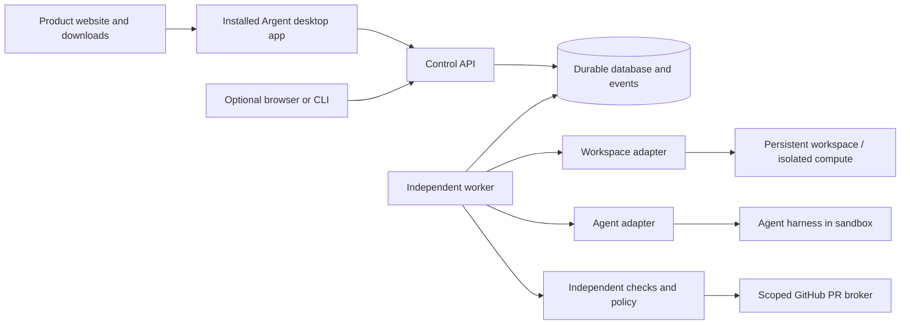
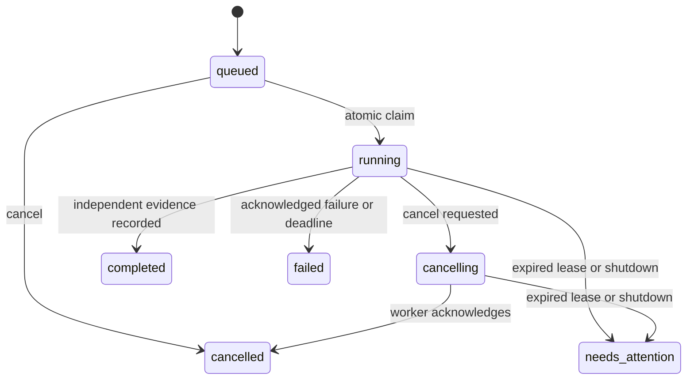

# Architecture

Status: the M0 engine, the P1 local desktop prototype and the P2 desktop shell are
implemented. The desktop app runs Claude Code in local worktrees
([spec 0013](docs/specs/0013-local-mvp.md), slices L1.1 and L1.2); GitHub-URL
workspaces and the cloud work remain simulated. The managed architecture below is
the proposed later target.
No upstream fork, cloud deployment or paid resource is configured.

## Shape and boundaries

A modular monolith with separate API and worker processes. An installed desktop
application is the primary client; it reads state and sends commands without
owning execution. A public website distributes installers and documentation.
Browser access may be added as a secondary client. Keep authoritative execution
state outside suspendable workspace compute.

M0 implements the control API, durable SQLite store and independent worker with
local simulation adapters. P1 adds the installed desktop client and local download
page source. L1.1 and L1.2 add Claude Code in local worktrees. Real cloud
workspaces and the GitHub PR broker remain M1 targets. Verification checks a
simulation artifact or records local Git evidence; executing trusted repository
tests remains planned.

## Persistence and execution

M0 stores workspaces, runs and ordered events in SQLite with WAL, full synchronous
commits, foreign keys and indexed run/event lookups. `BEGIN IMMEDIATE` serializes
claims and state transitions across processes. A partial unique index permits
one active run per workspace. An application guard also blocks uncertain runs.
Run insertion and its queue event commit together; completion and verification
evidence commit together. There is no separate in-memory task queue.

A claim persists a random fencing token, lease expiry and absolute execution
deadline before invoking an adapter. Heartbeats extend a live lease only. Every
worker write validates ownership. The API omits fencing tokens from responses.
Idempotency keys deduplicate submission and reject changed payloads.

An unknown outcome is never retried automatically. `needs_attention` blocks
new work and lifecycle changes for the workspace. P1 adds audited abandonment
for simulated runs only; real-provider reconciliation remains future work.
Reconnect reads run state and events after an
ordered cursor; it does not dispatch work. No exactly-once external-effects
guarantee is claimed. A database token cannot fence a Git push or cloud process.

The worker must remain running for execution and lease reconciliation. API
availability and worker availability are independent; neither survives shutting
down this local computer. Cloud-hosted workers are required for laptop independence.
The scripted adapter is cooperative and bounded. Arbitrary blocking code must
never run inside the control-plane process; future adapters control isolated
processes with provider-enforced resource/deadline limits.

## Desktop delivery

P1 uses Electron 45.2.3 with a sandboxed, context-isolated renderer and no Node
integration. Packaged assets load through an allowlisted custom protocol and CSP.
The preload exposes named operations only; the main process validates the exact
main-frame sender and translates operations to authenticated loopback requests.
Only the service/main process can read the private operator credential.

The desktop's detached service cohosts the HTTP API and bounded worker loop for
this single-host prototype. The original separate API/worker mode remains tested.
A separate SQLite ownership database holds an exclusive OS-backed lock while the
service runs; process death releases it without relying on PID liveness. API and
worker data use the main WAL database. The desktop reconnects to a service by
private instance identity and health challenge, not just an open port.

The first usable prototype must launch as a local desktop application, with
workspace/task controls, activity history and verification details. The desktop
shell must keep privileged filesystem/process APIs and credentials outside its
renderer, use a narrow validated bridge, and load only trusted packaged content.
It connects to a persistent local service or a configured remote control plane.
Window close, application exit and explicit execution-service shutdown are
separate lifecycle operations.

Provide a packaged macOS prototype first in this development environment. Track
Windows/Linux packaging separately. Public distribution requires signed/notarized
artifacts where applicable, versioned downloads, checksums and a verified update
path. An unsigned local build must not be represented as a public-ready installer.
The website must describe available builds truthfully and never offer fabricated
download links. No publication or paid signing account is implied by development.

## Internal lifecycle simulation

`Store.lifecycle` shares M0's SQLite connection through a separate
`LifecycleStore` module. Dedicated lifecycle workspace/operation/event tables
keep cloud lifecycle states distinct from metadata-only local stop/start.
Enrollment and M0 submission/claims serialize through the same database;
enrolled workspaces cannot execute via the local adapter, even when ready.

The internal simulation-only worker claims operations, records dispatch intent,
requires quiescence before pause and bounds calls with an absolute deadline and
fenced heartbeat. Expiry and ambiguous outcomes block dispatch. Read-only
provider inspection may settle the original operation if identity and target
state match; an absent create marker remains inconclusive. Delete requires
confirmed absence and retains its provider ID in an audit tombstone.

This harness is not wired into the public API, desktop bridge or service worker
loop. It has no live GitHub credentials, real checkout, persistence manifest,
real provider, resource policy or full cleanup inventory. Its simulation-only
adapter contract must not be expanded for real execution before those boundaries
are implemented and verified. See [spec 0007](docs/specs/0007-cloud-workspace-lifecycle.md).

## Internal repository access simulation

`Store.repositories` adds a separate repository operation/event queue on the same
SQLite connection. Bootstrap binds a ready lifecycle workspace and provider ID;
its enrollment and lifecycle requests serialize under the same write lock.
Pending or uncertain bootstrap blocks pause/delete. At most one non-failed
bootstrap per workspace is allowed; even a successful checkout is not repeated
under a new request key. Clean pre-mint failures permit a fresh request.

The simulation-only worker asks a trusted server-side authority to validate the
operator/repository/ref and return numeric repository/installation IDs. Client
input cannot select the installation or permissions. Each new operation checks
authority before requesting a single-repository Contents-read token. Returned
scope/expiry is validated before resolving a full commit SHA. Checkout receives
a credential-free fixed plan and a separate ephemeral credential argument; a
separate inspection call must match the plan with hooks/submodules/LFS disabled.

Intent precedes mint/checkout dispatch; leases fence state writes. The worker
attempts bounded token revocation and channel clearing on success or failure.
Success requires checkout verification and both cleanup acknowledgments.
Exceptions are never persisted. Unknown outcomes, expired ownership and cleanup
failure retain `needs_attention` plus token/channel obligations; reconnect only
reads. This is a separate bootstrap status, not a new lifecycle-ready guarantee.

An internal, simulation-only recovery path accepts the original authenticated
operator and performs bounded, read-only independent inspection. Only fresh,
identity-bound confirmation of settled effects, revoked/absent credentials,
cleared/absent channels and no partial checkout can resolve uncertainty. The
original attempt becomes `failed`, retaining its phase and cleanup history;
an attributed receipt and event commit with that transition. A new request key
must reauthorize before bootstrap. Rejections remain blocked and record only a
fixed reason. Completed duplicate keys read their receipt; concurrent inspections
are read-only and their settlements serialize with lifecycle requests. This
does not implement actual cleanup or bypass uncertain external outcomes.

Internal `RepositoryCredentialVault` adds encrypted simulation custody to the
same SQLite database (repository schema version 4). Mint intent reserves an opaque
reference transactionally. The caller explicitly supplies a dedicated 256-bit key
and key ID; no key is persisted or discovered from host credentials. AES-256-GCM
with fresh nonces authenticates the reference and operation/operator/workspace/
provider/repository/installation identities. Fenced capture and its event commit
before token acceptance/use, including overbroad supported-format tokens. The
original trusted operator may recover with the correct key through an internal
read only; this neither performs cleanup nor resolves an uncertain attempt.
Revocation acknowledgment erases active ciphertext transactionally with its event;
confirmed audited resolution also erases it, preserving historical states and the
reference. This is logical erasure, not physical WAL/backup deletion.

The fixtures prove contract handling only. The bootstrap/recovery harness has no
live GitHub adapter, real authorization/sign-in service, production key custody,
isolated Git runner or dependency execution. A crash before mint-response capture still leaves an
unknown token, and losing the injected key prevents recovery. Key rotation and
backup remain unimplemented. Production secret custody and live
isolation/credential-leak tests are mandatory before enabling
real adapters. In particular, an inspector must independently
prove old requests cannot complete after resolution; simulation does not prove it.
The installed client, public API and normal service worker remain on M0/P1.

`cleanupRepository` adds explicitly requested internal simulated recovery cleanup
(schema version 5). One transaction reserves one attributed attempt per uncertain
bootstrap, with a unique request key and absolute deadline. Duplicates only read;
no restart/reclaim or new key can repeat that cleanup. Independent fresh inspection
must confirm original effects have settled and bind operation identities plus the
cleanup ID/event cursor. Its timestamp and event commit before dispatch. Only a
recoverable active token is passed to revocation; channel/partial-checkout cleanup
receives the immutable original operation. Every action records intent and a
bounded acknowledgment; revocation erases custody transactionally. Failure stops
further dispatch. No original bootstrap history is rewritten and acknowledgment
alone leaves the workspace blocked.

Resolution additionally requires independently confirmed settled cleanup effects
for the exact cleanup ID/current event cursor. An active coordinator or stale
inspection cannot unlock the operation; deadlines/state fence late writes.
After process death, a historical `running` cleanup with an expired deadline is
not reclaimable; only independent inspection/manual recovery can settle it.
This contract supplies no production request fencing, cleanup or key management.

## Read-only GitHub preflight

`github-preflight.ts` contains a real fixed-origin GET transport, verified through
synthetic HTTP responses and the recorded live device pilot. A trusted caller supplies the operator,
previously linked GitHub user, selected numeric identities/ref and explicit
in-memory user token/App JWT. It checks user, repository, App installation policy
and branch identity through four read-only routes. It returns a labeled immutable
observation, not authorization to mint or execute; the API/renderer/service loop
has no entry point. No raw response body, credentials or exception text is returned.

The transport pins `api.github.com`/REST `2026-03-10`, separates App/user credentials,
prohibits redirects/retries and bounds total runtime and streamed bytes. Injected
transport always marks its result simulated. It neither implements OAuth consent/
binding establishment nor attests user-token issuer. These point-in-time reads
cannot fence later authorization/ref changes. Before live use, complete
[spec 0010](docs/specs/0010-live-repository-pilot-gates.md).

The simulation token parser and encrypted-envelope guard now share a 4,096-byte
bound for GitHub's opaque stateless installation-token format. Encoded claims are
never used to authorize access. Scope/expiry checks remain separate; compatibility
does not enable live adapters or supply production secret custody.

## Explicit GitHub device pilot

`github-device.ts` implements bounded App device sign-in with fixed GitHub POST
endpoints and protocol-compliant pending/slow-down polling. A lost exchange
response stops; there is no automatic retry/restart. Only the public user code and
verification URL leave the auth component. The opaque session keeps its token in
a private field, discards refresh credentials and exposes only read-only preflight.
Close/expiry blocks further reads. Closing is local forgetting, not remote revocation.

`github-pilot-key.ts` loads only an explicit private owned file/directory, rejecting
symlinks/hardlinks, unsafe modes, oversize data, weak/non-RSA keys and a mismatched
public fingerprint. It signs a short-lived RS256 JWT; no private-key export API is
exposed. `github-pilot.ts` ties this signer to device authentication and the existing
preflight under the local OS operator. An explicit private config supplies the
previously approved non-secret identities; `/user` must match the expected numeric
GitHub user before a successful receipt is returned.

`scripts/github-pilot.ts` is opt-in through `npm run github:pilot`. It saves only a
redacted immutable observation using an atomic rename beside the config, then
forgets the session token. This receipt is not a durable grant/state transition in
the execution store. No API, desktop bridge or worker command is added. This
single-host pilot needs no browser callback/public ingress and never inherits
host GitHub credentials. A live pilot has verified the expected user, private fixture and full SHA through
this path. Persistent refresh/revocation, production key custody, remote operator
authentication and isolated execution remain unimplemented.
See [spec 0011](docs/specs/0011-github-device-pilot.md).

## Managed target

Use PostgreSQL before multiple hosts or tenants. Preserve atomic state/event
writes, idempotency receipts, fenced claims and conservative reconciliation.
Use database-backed work dispatch initially; introduce an outbox when dispatch
crosses another service boundary, not a second uncoordinated queue.

Retain the current core for bounded M1a. T3 runtime evaluation is deferred until
measured complexity justifies it; source review alone does not prove superiority.
Keep lifecycle machinery narrow and do not build a general workflow system. Temporal or DBOS is
an option once actual branching/retry complexity justifies the operational cost.

First cloud candidate: E2B; alternatives are Vercel Sandbox or a maintained
open runtime. `WorkspaceAdapter` owns lifecycle and opaque provider IDs.
`AgentAdapter` translates official sessions/events, cancellation and usage.
The M0 interfaces intentionally implement only the exercised operations;
expand them alongside real provider contract tests rather than inventing a
universal protocol. ACP may help interoperability; MCP supplies tools, not our
durability or workspace lifecycle.

Persist repository ID, installation ID, provider workspace ID, base/head commit,
worktree/branch, runner identity, agent session reference, policy version,
execution attempts, approvals and evidence references. Keep transcript/session
files on retained storage: a saved session ID alone is insufficient recovery.

Idle suspension is allowed only after the runner has acknowledged quiescence.
E2B pause restores memory and processes; never equate unpause with starting a
fresh task. On a crash, reconcile existing provider/run identity before issuing
commands. An unknown outcome requires human action. A stop/snapshot preserves
files but may not preserve processes; adapter capabilities must be explicit.

## Evidence and external actions

Verification is owned by the orchestrator and records command argv, trusted
policy source, exit status, timestamps, stdout/stderr artifact references and
tested commit SHA. Execute it in isolated compute. Do not accept a modified
agent-owned test script as sufficient independent evidence; compare policy and
test changes to the trusted base and surface changes for review.

Capture diffs and test evidence for the exact commit proposed in a PR. A PR
broker, outside the agent sandbox, uses a GitHub App installation token scoped
to the selected repository. It creates a draft PR only after policy passes and
records the returned external ID. After a timeout, inspect provider state by
branch/run marker before any retry. Push/PR/merge are distinct approved effects.
The MVP never automatically merges. Repairs have an explicit finite attempt
budget; failed evidence remains visible.

## Security and operations

M0 uses a unique operator bearer token and loopback binding. It rejects browser
origins, validates inputs, caps bodies/events and never launches repository code.
It has no tenants, TLS termination, OAuth, production secret store or public
ingress. Local workspace directories persist files; they are not a sandbox.
The desktop service additionally enables the local Claude Code adapter, as
described below. Trusted host owners can inspect or alter local state; this
prototype is not tamper-resistant evidence storage.

The managed product needs authenticated users and authorization on every
workspace/run/artifact, isolated microVM execution, no host mounts or Docker
socket, restricted egress, resource quotas, controlled artifact URLs, encrypted
secrets, short-lived scoped credentials and redaction before event storage.
Never copy desktop subscription credentials into hosted workers. Separate an
agent's inference credential from GitHub/cloud control-plane credentials.

Track runtime, provider storage, token usage and budget reservations. Provider
usage may arrive after requests complete; accounting alone is not a hard spend
cap. Combine bounded runs/turns, preflight budgets and provider account controls.
Deletion must revoke credentials and explicitly address retained disks,
snapshots, logs and backups; suspension is not deletion. Provider IDs and cleanup
intent must be recorded before and after external lifecycle operations so crashes
do not silently orphan resources.

See [due diligence](docs/research/technical-due-diligence.md) for dated evidence
and [MVP acceptance criteria](docs/specs/0002-cloud-mvp.md) for release gates.

## Planned continuity and control requirements

The [roadmap](ROADMAP.md) adds portable history/evidence
restore and visible real-execution controls to managed release. The
[continuity contract](docs/specs/0006-portable-continuity.md) defines
manifest integrity/completeness, credential exclusion and restore to an independent
installation with our hosted endpoints unavailable. Imported active/uncertain
work must reconcile or remain `needs_attention`; restore cannot dispatch an old
external effect or promote imported agent statements into trusted evidence.

Expose execution location, durable progress, connection freshness, blocked input
and verification separately. Specify approval/input transitions and timeouts with
the real agent adapter. Supported subscription sign-in is a product preference,
subject to provider/deployment validation; API keys remain the technical-pilot
path. Neither preference permits extracting host credentials or silently switching
to paid API usage. The offline historical slice below is implemented; real-execution
controls and full managed continuity remain open. Process boundaries and the
target diagram above remain unchanged.

## Offline historical continuity

`continuity-export.ts` opens an explicit source database read-only and reads one
consistent M0/P1 workspace snapshot. It rejects cloud lifecycle/bootstrap records
instead of omitting their cleanup obligations. The versioned JSON format in
`continuity.ts` contains projected metadata/events, optional selected text and
canonical fixed simulator artifacts, hashes, bounds and an omission inventory.
No lease, request key, credential envelope, raw event payload or discovered file
is exported. Text is private opt-in data, not automatically sanitized prose.

`ContinuityStore` restores validated bundles into a separate, application-identified
private SQLite database. Each immutable import and its event commit together;
identical digests deduplicate. This database has no workspace/run dispatch tables.
Historical views normalize imported active/uncertain statuses to `needs_attention`
while retaining original status; all imported verification remains untrusted and
simulated. Checksums establish integrity, not authenticity or fresh verification.
The offline CLI does not import workers, call providers or extract scripts/files.
No API/desktop bridge capability or remote ingress is added.
See [spec 0012](docs/specs/0012-portable-history.md) for the scope and test contract.

## P2 desktop presentation

[Spec 0008](docs/specs/0008-desktop-workspace-shell.md) organizes the renderer
into workspace/session navigation, central activity/composer and a right inspection/
terminal shell. `ui/shell.ts` contains presentation-only navigation; its packaged
script is explicitly allowlisted. The existing app/bridge owns validated service
commands. The composer opens the existing task/runtime review and preserves any
read-only uncertain submission. Settings collects no credentials. Planned terminal,
file/diff, migration and mobile surfaces invoke no external effects. The headless
engine, loopback boundary and execution ownership are unchanged.

P2.1 bundles licensed Lucide SVG masks and uses an exact local protocol asset
allowlist populated from packaged SVG filenames. No remote icon/font resources
or renderer privileges are added. Presentation state includes workspace-scoped
memory-only composer drafts and keyboard tab/search navigation. See
[the desktop UX contract](docs/specs/0009-desktop-ux-polish.md).

## P3 desktop restyle

[Spec 0015](docs/specs/0015-desktop-restyle.md) replaces the P2 layout. The
renderer is split into small modules: DOM helpers, a pure presentation model
(tested in Node), state, and views for the sidebar, conversation, record,
composer and search. Each workspace shows one conversation, with every run as a
turn that ends in Argent's record. The composer calls the existing `createRun`
bridge method directly with an idempotency key; an unconfirmed key is kept and
retried, never regenerated. Placeholder inspector, terminal, migration and mobile
surfaces are removed. The protocol allowlist is still built at startup from strict
filenames: the renderer's own `*.js` modules, `icons/*.svg`, `fonts/*.woff2` and
two brand images. No bridge method, renderer privilege or network access is added.

The existing `/service/stop` response explicitly closes its keep-alive socket so
an interrupted desktop service can finish draining and release ownership. It
preserves the existing worker-shutdown `needs_attention` state and does not replay
work. The API/worker/store boundaries and loopback restriction remain unchanged.

## Local execution mode (engine and desktop controls implemented)

[Spec 0013](docs/specs/0013-local-mvp.md) adds a second workspace provider beside
the simulation. A `local-worktree` workspace records a local repository, its base
commit, a branch `argent/<id>` and a worktree under the service's private data
directory. The same worker claims its runs with the same leases, deadlines,
cancellation and reconciliation; only the adapters differ. The Claude Code
adapter launches the official CLI in the worktree as a child process group,
writes the task to standard input and maps its JSON event stream to bounded log
events. Completion evidence is the worker's own inspection of the worktree
(commit, changed files, diff hash), never the agent's statement.

The detached desktop service is both the control plane and the execution host in
this mode, on the developer's own computer and as the developer. That is a
deliberate, labelled exception for local use: it is not isolation, and a remote
or managed control-plane host still never executes repository code. Argent's own
Git commands disable hooks and fsmonitor, every process is started without a
shell, and agents receive an allowlisted environment without provider API keys.
The repository folder reaches the service only from a native dialog in the
desktop main process, or from a workspace the service already recorded; the
sandboxed renderer cannot pass a path.

### Local hardening contract

The implemented [local hardening acceptance criteria](docs/specs/0013-local-mvp.md#local-execution-hardening)
require a supervisor to retain process-group ownership until quiescence, including
early transcript rejection. Unconfirmed termination blocks the workspace;
database leases and operator notes do not prove an old process has stopped.
Durable process reconciliation after a service crash remains unimplemented.

Trusted Git commands use bounded asynchronous child processes and neutralize
configured filters. Repositories containing submodules are unsupported: their
nested configuration and contents cannot be safely covered by parent-only
inspection. Versioned evidence binds untracked content as well as tracked diffs,
with explicit size and filesystem limits. This is a record of Git-visible content,
not a sandbox, a test result or an atomic filesystem snapshot.

The desktop service has two worker slots, sharing atomic store claims and a
single-run-per-workspace constraint. Shutdown drains all slots before closing
the store. The renderer retains the selected run's bounded event history and
paginates it without changing execution ownership.
