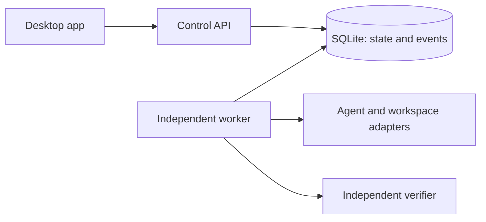

# Argent

**An open-source desktop app for handing coding tasks to AI agents and reviewing
results you can verify.** Agents work in persistent workspaces, the work keeps
its record when you disconnect, and nothing counts as done until an independent
check says so. You decide what gets merged.

> **Status: early prototype.** The durable engine and the macOS desktop app work
> today. The desktop app can run **Claude Code on a local repository**, each
> workspace on its own branch and Git worktree, using your own `claude` sign-in.
> Local execution is **not a sandbox**: the agent runs as you. There is no diff
> view, test runner, pull-request flow or cloud workspace yet, and the GitHub-URL
> workspaces remain a scripted simulation. Everything below says which parts are
> real and which are planned.

Follow the build on X: [@Argent_build](https://x.com/Argent_build).

## What works today

- **A durable local engine.** An API and an independent worker share a SQLite
  store. Runs survive the API process crashing; a client reconnects and replays
  the ordered event history from its last cursor.
- **Safe failure handling.** If a worker disappears mid-run, the run becomes
  `needs_attention`. Argent never retries something that may already have
  happened; a person reviews it first. An interrupted real run keeps its
  workspace blocked: a note cannot unblock it, because nothing yet proves the
  earlier process has stopped. See
  [local hardening](docs/specs/0013-local-mvp.md#local-execution-hardening).
- **Independent evidence.** A run completes only after Argent checks the result
  itself instead of trusting the agent: for a local Claude Code run, the branch,
  commit, changed files and a SHA-256 of the diff (recorded, not tested); for a
  simulation, the artifact's identity and SHA-256.
- **A desktop app** (macOS, Apple Silicon, unsigned local build): workspaces,
  tasks, live activity and verification details. Closing the app leaves the
  local service running, and reopening it reconnects to the same history.
- **Offline history export and restore**, as a CLI.
- **Claude Code in local worktrees** (L1.1 and L1.2): choose a repository folder
  and Argent creates branch `argent/<id>` in a private worktree, leaving your
  checkout untouched. Claude Code runs there through its official CLI with a live
  transcript, follow-ups that continue the same conversation, cancellation and a
  per-run choice between edits only (the default) and full access. Start a
  parallel workspace on the same repository with one click. Requires the `claude`
  CLI installed and signed in; Argent never passes API keys. See
  [spec 0013](docs/specs/0013-local-mvp.md).
- **An opt-in, read-only GitHub sign-in pilot** using GitHub's device flow. It
  is not connected to the desktop app or to task execution.

## Where it is going

The full [roadmap](ROADMAP.md) lists each milestone and the evidence it needs.
In order:

1. **Local MVP (in development).** Real coding agents on your own computer:
   each workspace is a new branch in its own Git worktree of a local repository,
   so tasks run side by side without overwriting each other. It ships with Claude
   Code first, then Codex, each through its official CLI and your own sign-in;
   every workspace chooses its agent and every run its model (Claude models or
   GPT models). You follow the session live, review the diff and test results,
   and open a draft pull request.
   Local execution is not a sandbox: the agent has the same access as running it
   in your terminal. See [spec 0013](docs/specs/0013-local-mvp.md).
2. **Cursor and OpenCode**, through their official interfaces.
3. **Signed public downloads** from the website.
4. **Cloud workspaces.** Hand off a task, close your laptop, and come back to a
   tested draft pull request.
5. **A mobile companion** (native iOS) to check progress and steer from your
   phone.

After that: team handoff, then dependent tasks. A full IDE, agent swarms and
automatic merging are explicitly out of scope for now.

## Principles

- **An agent's claim is not proof.** Trusted checks run against the exact commit
  and are recorded separately from what the agent says.
- **Stop when unsure.** An unknown outcome blocks the workspace until someone
  inspects it; reconnecting only reads state.
- **Self-hosting is first-class.** The core is MIT-licensed and runs without our
  servers or any particular model provider. A managed cloud, if offered, would
  run the same core.
- **Credentials stay separate.** Agents use their official local sign-in and
  receive an allowlisted environment without provider API keys or host tokens.
  Local execution still has the developer's filesystem and credential access.

## Quick start

You need Node.js **22.19.0** or a later 22.x release, npm 10.9.3 and Git. No
Docker, cloud account or model key is needed.

For real tasks, install and sign in to the official Claude Code CLI. Before each
task Argent checks that the CLI is recent enough and tells you if it is not; it
bounds the CLI's output and refuses repositories that contain submodules. See
[local hardening](docs/specs/0013-local-mvp.md#local-execution-hardening).

```sh
git clone https://github.com/GregPat22/argent.git
cd argent
npm ci
npm run check     # types, formatting and the full test suite
npm run demo      # headless durability demo
npm run desktop   # launch the desktop app
```

`npm run demo` starts real API and worker processes, submits a simulated task,
kills the API in the middle of the run, starts a new API and reads the same
verified history back. It leaves its database and artifact in a printed
`.data/demo-<id>` directory.

To build a self-contained macOS Apple Silicon app:

```sh
npm run desktop:smoke     # drives the real app; needs a macOS GUI session
npm run desktop:package
open release/Argent-darwin-arm64/Argent.app
```

Packaging produces `release/Argent-0.0.1-macos-arm64.zip` plus a `.sha256`
checksum. The app bundles its own runtime. It is **unsigned and not notarized**:
a local preview, not a public release. Windows, Linux and Intel Mac builds have
not been built or tested.

## How it works



The API records a run and its first event in one transaction. The worker claims
it atomically under a fenced lease, writes logs and completes the run only after
independent verification. API requests never own a running task. The desktop app
starts or reconnects to a detached local service that hosts the API and worker;
its renderer is sandboxed and never sees credentials. See
[ARCHITECTURE.md](ARCHITECTURE.md) for the state machine, trust boundaries and
the planned cloud design.

| Layer          | Technology                                                    |
| -------------- | ------------------------------------------------------------- |
| Runtime        | Node.js 22.19.x, strict TypeScript, ESM                       |
| Desktop        | Electron 45.2.3 with a sandboxed renderer and a narrow bridge |
| Persistence    | Built-in `node:sqlite`, WAL, full synchronous commits         |
| Tests          | Node test runner, real multi-process crash/reconnect tests    |
| Planned cloud  | PostgreSQL plus an isolated workspace provider (E2B is first) |
| Planned agents | Official agent CLIs; Claude Code first, then Codex            |

`node:sqlite` is experimental in the tested Node release. The current engine is
built for a single trusted host on loopback, not for multi-tenant production.

## Configuration

**Desktop:** nothing to configure. Argent creates a private local service
credential and stores its data in `~/Library/Application Support/Argent/`. Set
`ARGENT_DESKTOP_DATA_DIR` to use an isolated data directory for development.

**Standalone API and worker (optional):** copy `.env.example` to `.env`, set a
unique token of at least 32 characters, and use the same `PLATFORM_DATA_DIR` for
both processes. Generate a token with:

```sh
node -e 'console.log(require("node:crypto").randomBytes(32).toString("hex"))'
```

Then build once and run each process in its own terminal:

```sh
npm run build
npm run start:api      # terminal 1
npm run start:worker   # terminal 2
```

The demo uses its own disposable token; never reuse it for a real deployment.

## Local API

The API binds only to `127.0.0.1:4310`. Send `Authorization: Bearer <token>` on
every request.

| Method | Route                                       | Input / behavior                                                                                                                                |
| ------ | ------------------------------------------- | ----------------------------------------------------------------------------------------------------------------------------------------------- |
| GET    | `/health`                                   | Authenticated status information.                                                                                                               |
| POST   | `/workspaces`                               | `{"repository":"https://github.com/owner/repo"}`; metadata only.                                                                                |
| POST   | `/workspaces` (desktop service only)        | `{"source":"local","path":"/absolute/repo"}`; creates a branch and worktree.                                                                    |
| GET    | `/workspaces?limit=50&before=<id>`          | Keyset-paginated workspace list.                                                                                                                |
| GET    | `/workspaces/:id/runs?limit=50&before=<id>` | Keyset-paginated task history.                                                                                                                  |
| GET    | `/workspaces/:id`                           | Read persisted workspace state.                                                                                                                 |
| POST   | `/workspaces/:id/stop` or `/start`          | Preserve identity and files; refuse active or uncertain work.                                                                                   |
| POST   | `/runs`                                     | `{"workspaceId":"…","task":"…","maxRuntimeMs":30000}`; requires `Idempotency-Key`. Local runs also take `"permissionMode":"edits"` or `"full"`. |
| GET    | `/runs/:id`                                 | Status and limits; the worker's fencing token is never returned.                                                                                |
| GET    | `/runs/:id/events?after=0&limit=100`        | Ordered events and `nextCursor`; persist the cursor to reconnect.                                                                               |
| POST   | `/runs/:id/cancel`                          | Persist cancellation; the worker acknowledges it cooperatively.                                                                                 |
| GET    | `/runs/:id/artifact`                        | The artifact, after checking its committed SHA-256.                                                                                             |
| POST   | `/runs/:id/resolve`                         | `{"note":"…"}`; audited abandonment of an uncertain simulated run.                                                                              |

Repeating a submission with the same key and payload returns the original run; a
changed payload returns 409. Simulated runtime is bounded to 100–300,000 ms (default 30 s);
local runs to 1 s–2 h (default 30 min) and 2,000 log events.
A simulated run can emit at most 100 log events of up to 2,048 characters each, and request
bodies are capped at 16 KiB. The desktop service also exposes an authenticated
`/service/stop`, which standalone mode does not enable.

## Offline history export and restore

`npm run continuity -- help` lists the export, inspect, restore, list and show
commands. Export reads one workspace from a consistent read-only snapshot.
Metadata is exported by default; task and log text and simulated artifacts need
`--include-text`. Credentials, leases and arbitrary files are never exported.
Text is not sanitized, so review it for secrets before sharing a bundle.

Restore writes a separate, read-only history database with no execution queue.
Imported in-progress or uncertain work is shown as `needs_attention`, and imported
checks never become trusted evidence. See
[spec 0012](docs/specs/0012-portable-history.md#using-the-offline-cli) for the
exact commands, format and limits.

## Read-only GitHub pilot

```sh
npm run github:pilot -- --config /absolute/private/github-pilot.json
```

This opt-in command signs a GitHub App user in through GitHub's device flow,
checks the expected user, App installation, repository and read-only permissions,
and reads the exact branch SHA. It writes a redacted receipt next to the config.
The config and signing key must be regular files you own with `600` permissions
inside `700` directories. User and refresh tokens are never saved, and no host
credentials are discovered.

The pilot does not mint installation tokens, clone code or connect to the desktop
app. See [spec 0011](docs/specs/0011-github-device-pilot.md) for the config format
and [spec 0010](docs/specs/0010-live-repository-pilot-gates.md) for the gates
before live repository access.

## Development

| Script                    | Purpose                                                       |
| ------------------------- | ------------------------------------------------------------- |
| `npm run build`           | Compile source, tests and scripts into `dist/`.               |
| `npm run typecheck`       | Strict type checks without output.                            |
| `npm run format`          | Apply Prettier.                                               |
| `npm run format:check`    | Check formatting without edits.                               |
| `npm test`                | Build and run all unit and process tests.                     |
| `npm run check`           | Typecheck, formatting and all tests.                          |
| `npm run start:api`       | Run the built loopback API.                                   |
| `npm run start:worker`    | Run the built independent worker.                             |
| `npm run demo`            | Build and demonstrate API restart and reconnection.           |
| `npm run desktop`         | Build and launch the desktop app.                             |
| `npm run desktop:smoke`   | Drive the real Electron app and capture a screenshot.         |
| `npm run desktop:package` | Build a self-contained macOS arm64 app with a zip and digest. |
| `npm run site:preview`    | Serve the static download preview with local build artifacts. |
| `npm run continuity`      | Offline history export and restore CLI.                       |
| `npm run github:pilot`    | Opt-in device sign-in and read-only repository preflight.     |

Tests use temporary on-disk databases and real child processes: they kill API and
worker processes, race claims and check the durable history. They need permission
to listen on loopback and spawn processes, and they call no billable API. Test
files run serially so process startup on a busy machine doesn't eat into short
test leases. `desktop:smoke` needs a macOS GUI session and checks that the
renderer has no Node access and that the service survives the app exiting.

### Project layout

| Path           | Contents                                                               |
| -------------- | ---------------------------------------------------------------------- |
| `src/`         | API, durable store, worker, adapters, continuity and GitHub pilot code |
| `src/desktop/` | Electron main process, preload bridge and detached local service       |
| `ui/`          | The credential-free desktop renderer                                   |
| `tests/`       | Unit and multi-process integration tests                               |
| `scripts/`     | Demo, packaging, smoke, continuity and pilot entry points              |
| `website/`     | The landing page (Next.js) and the static download preview             |
| `docs/`        | Acceptance specs, milestone reports, research and decisions            |

## Contributing, security and license

Read [CONTRIBUTING.md](CONTRIBUTING.md) before opening a pull request; work starts
from a written spec with acceptance criteria. Coding agents should follow
[AGENTS.md](AGENTS.md). Report vulnerabilities privately as described in
[SECURITY.md](SECURITY.md), not in public issues.

Argent is original code released under the [MIT license](LICENSE). The bundled
Lucide icons keep their own license notices in [ui/icons](ui/icons/README.md).
