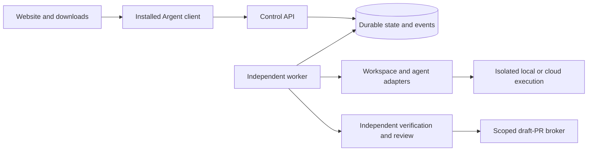

# Argent: project context

Context snapshot: 6 November 2026. This page lets a new contributor or coding agent
understand the project without access to private chats. It describes accepted
product intent and the tested foundation in this publication. Read
[AGENTS.md](../AGENTS.md) before making changes.

**Latest cross-branch progress:** [HANDOFF.md](../HANDOFF.md). Current branch
`GregPat22/next-step-v6` now includes main `8acab52`, including the familiar
desktop shell/UX, landing refinements and encrypted simulated credential custody.
It adds audited simulated cleanup of uncertain repository bootstraps, an unwired
read-only GitHub preflight, current token-format compatibility and an explicit
memory-only device pilot with live private-fixture evidence. Independent
resolution still gates workspace reuse. See
[spec 0007](specs/0007-cloud-workspace-lifecycle.md) for acceptance and limits.
Durable desktop account connections, cloud execution, migration and mobile remain
planned. [Spec 0011](specs/0011-github-device-pilot.md) records the local sign-in
pilot and its limits.
[Live pilot gates](specs/0010-live-repository-pilot-gates.md) record the current
credential/authorization/isolation stopping point.

## What we are building

Argent is an open-source, desktop-first development platform where AI coding
agents work in persistent local or cloud environments and developers stay in
control from anywhere. The name combines _argento_, Italian for silver and a
conductor, with _agent_.

The primary experience is to visit a website, download Argent, install it and
launch a desktop app. The website distributes builds and documentation. A
browser-only dashboard does not satisfy the founder's requirement. The desktop
app controls a headless execution service: installing a desktop client does not
mean cloud tasks depend on that computer remaining connected.

Conductor is the explicit daily-workflow and UX reference: familiar workspace,
chat/composer, inspection and terminal placement should reduce switching friction.
Argent retains reliable execution, visible evidence and human control. The founder
now prioritizes subscription breadth, cloud migration and a mobile companion ahead
of team/dependency work; a one-agent proof is not the replacement product launch. We intend to serve developers and small teams,
including displaced Conductor users and engineering teams wanting handoff and
inspectable evidence. These groups overlap; a shared core supports all three.
The first technical proof remains bounded delegation and review. Team handoff
is staged after that proof. This is product direction, not validated demand.

## What we learned from the Conductor shutdown review

The founder authorized saving the findings and updating the roadmap on
`GregPat22/grok-conductor-shutdown-analysis`, based on main `fd60a5a`.
Read the [full research](research/conductor-shutdown-analysis.md) for dated sources
and the [continuity contract](specs/0006-continuity-and-market-validation.md)
for planned acceptance criteria.

- The official cloud closure is real; it reinforces independent execution and
  practical ownership. Existing hosted and self-hosted alternatives already
  overlap our promise. Compare actual workflows before claiming a unique gap.
- The founder verified Grok's underlying X material. Our direct retrieval of
  several posts was blocked; sentiment prevalence, demand, willingness to pay and
  competitor reliability remain unmeasured. Do not promote anecdotes into metrics.
- Prefer supported subscription sign-in for product onboarding, with API keys as
  an alternative and the first controlled technical-pilot baseline. Provider
  policy differs between local, customer-operated remote and managed deployment.
  Eligibility must be verified; never extract host credentials or silently switch
  to billable API usage after a subscription quota is exhausted.
- Add visible execution location, durable progress, freshness, blocked-input and
  recovery controls to real execution. Autonomous work still needs human steering.
- Practical independence requires versioned export/restore to another installation
  with our hosted endpoints unavailable. Preserve uncertain outcomes; never replay
  an external effect merely because records were imported. Full Conductor
  live-session migration is unproven and not promised.
- The latest founder revision moves additional agent/subscription support,
  migration and a mobile companion ahead of team handoff and dependencies. Native
  iOS is an explicit delivery track after the safe remote-client contract; native
  availability remains unimplemented. Advanced enterprise capabilities stay later. Retain Electron until measured evidence warrants a
  change; the research does not approve a foundation replacement.

## Intended developer journey

The eventual workflow is:

1. Connect a GitHub repository with narrowly scoped authorization.
2. Define work as specifications with observable acceptance criteria.
3. Identify dependencies and assign an eligible task to a coding agent.
4. Prepare an isolated persistent workspace and a task branch or worktree.
5. Run the agent with bounded time, permissions, resources and cost.
6. Capture durable activity while the developer disconnects.
7. Verify the actual changes with trusted tests for the exact commit.
8. Review the diff independently and allow only bounded repair attempts.
9. Prepare a draft pull request with retained evidence and clear limitations.
10. Let a human decide whether to merge; continue eligible dependent work later.

The larger vision includes Codex, Claude Code and OpenCode. The MVP narrows this
to one repository, one workspace and one real agent before coordinating many
agents or dozens of dependent specifications.

## What is actually implemented here

This branch contains **P1: the local desktop prototype**, built on the M0
orchestration simulator. Its scripted agent writes fixed JSON; it cannot run
repository commands or call a model. The desktop provides a native interface,
reconnection, artifact inspection and a detached local service. An internal
simulation-only lifecycle store/worker additionally exercises provider operation
claims, pause/resume/delete, uncertain outcomes and read-only reconciliation.
It is not connected to the desktop API and proves no real cloud capability. See the
[P1 completion report](milestones/0001-completion.md).

| Area         | Implemented in this publication                                                                                         | Remaining product work                                                               |
| ------------ | ----------------------------------------------------------------------------------------------------------------------- | ------------------------------------------------------------------------------------ |
| Interface    | Electron desktop, loopback API, CLI demo, local download preview and landing draft                                      | Signed public desktop distribution, website deployment and remote access             |
| Workspaces   | Local metadata, retained artifact directories, stop/start guards                                                        | Git checkout, isolated local execution and real cloud lifecycle                      |
| Dispatch     | Durable SQLite queue, atomic claims, fenced leases                                                                      | Real provider dispatch and external-effect reconciliation                            |
| Recovery     | Ordered events, API restart/reconnect, uncertain-run blocking, simulated resolution/cleanup and encrypted token custody | Real audited cleanup, production key custody, cloud reconciliation and backup drills |
| Execution    | Bounded scripted simulation, cancellation and deadlines                                                                 | Official coding-agent integrations with permitted authentication                     |
| Verification | Independent JSON identity check and SHA-256 evidence                                                                    | Trusted repository tests, exact-commit evidence and review policy                    |
| GitHub       | Source/CI and an explicit read-only App device pilot                                                                    | Durable desktop accounts, scoped bootstrap, push and draft-PR broker                 |

Publishing this source to GitHub does not implement the product's GitHub
integration. A passing simulation is not a tested pull request. The [desktop specification](specs/0004-desktop-prototype.md) is implemented
for a local macOS Apple Silicon prototype. It is not a signed public release.

The [M0 completion report](milestones/0000-completion.md) records 22 passing tests
and independent review repairs. The P1 completion report records 33 tests and
packaged-app checks. Evidence applies to the recorded revisions and scope, not
future changes or real providers. New changes require fresh checks.

## Architecture that must survive implementation

The API, durable store, worker and provider adapters remain separate modules in
one package. The API accepts commands and reads state; an independent worker owns
execution. SQLite serves one trusted local host. PostgreSQL is required before
multiple control-plane hosts or a managed multi-tenant service.

This is a target diagram. M0 implements the API, store, worker and simulation
adapters; P1 adds the local desktop and download-page source. Real isolated
compute, trusted repository verification and the PR broker remain future work.

Persist each transition and its event in one transaction; claim work atomically.
Idempotency keys deduplicate accepted submissions. Fencing tokens reject stale
worker writes, but do not fence a Git push or cloud API. Reconnecting only reads
state and events; it never resends an uncertain effect.

Distinguish these kinds of persistence:

- **Workspace persistence:** repository files, dependencies, configuration and
  artifacts survive compute suspension.
- **Process persistence:** a particular provider may restore memory and live
  processes. This requires provider-specific testing, not an assumption.
- **Execution history:** the control plane retains intent, attempts, events,
  evidence and external IDs independently of workspace compute.
- **Agent sessions:** a session ID is a reference. Recovery also needs retained
  session/transcript files and valid provider lifecycle semantics.

A lost lease or unknown external outcome becomes `needs_attention`, not an
automatic retry. Local runs still depend on their host and worker being alive.
Laptop-independent work requires a remotely available control plane and worker.
See [Architecture](../ARCHITECTURE.md) for state transitions and trust boundaries.

## Reuse, providers and unresolved choices

The current code is an original, narrow conformance foundation. No upstream
application has been forked or imported. Evaluate a pinned T3 Code revision
against M0's invariants before growing a substantial custom orchestrator. Compare
actual behavior, license obligations, adoption effort and cloud requirements;
obtain founder approval before replacing the foundation.

E2B is the first cloud candidate and Codex through an official interface is the
first real-agent candidate. These are recommendations, not completed integrations
or permission to spend. Vercel Sandbox and an open self-host runtime remain
alternatives. Provider capabilities, authentication terms, pricing and upstream
licenses must be checked again at the point of adoption.

Reuse existing isolation infrastructure, Git/worktrees, GitHub Apps, official
agent interfaces and established databases. Own the product's task identity,
approval policy, evidence requirements, cleanup intent, recovery behavior and
developer experience. Do not build a VM runtime, full editor or generic
distributed workflow engine before evidence justifies it.

The [due diligence](research/technical-due-diligence.md) records dated sources and
tradeoffs. The [decision register](DECISIONS.md) separates accepted requirements
from provisional recommendations and open choices.

## Security, budgets and human authority

Treat agent output and generated code as untrusted. Verification policy comes
from a trusted source; an agent's success message cannot override failed checks.
Review changes to tests and policy as well as application code.

The current local adapter is not a sandbox. Never attach a general coding agent
to the control-plane host through it. Real execution needs isolation, scoped
credentials, controlled egress and resource limits. Do not copy host credentials
or consumer subscription tokens into agents. Keep inference credentials separate
from GitHub and cloud control-plane credentials.

M0 binds loopback and has no tenants, TLS ingress or production authorization.
Do not expose it publicly. A public source repository does not authorize public
runtime ingress. Do not provision paid resources, deploy, merge or purchase
without the relevant explicit authorization. Publishing source is separate from
distributing a signed installer or deploying a website.

Budget accounting is not a hard spending cap. The real MVP needs bounded wall
time, turns, resource quotas, preflight reservations and provider controls.
Suspend only after quiescence acknowledgment. Cleanup must account for tokens,
compute, disks, snapshots, logs and retained artifacts; stopping compute is not
deletion.

## Open source and business direction

The goal is a usable local/self-hosted core that does not require our servers or
a particular model provider. The contemplated business is paid managed cloud
workspaces and execution, with collaboration, support and enterprise features.
Pricing, packaging and paid feature boundaries have not been finalized.

The original code is MIT-licensed. Commercial use is permitted, including by
competitors; MIT does not reserve the hosted-service market for Argent. Future
licensing or proprietary modules require review of code ownership, contributions
and third-party obligations. See [the license](../LICENSE) and
[identity decisions](specs/0003-project-identity.md). No company formation,
trademark clearance or domain registration is implied by this repository.

## How to continue without losing the context

Read the [documentation index](README.md), [founding brief](FOUNDING_BRIEF.md),
[vision](../VISION.md), [roadmap](../ROADMAP.md) and relevant acceptance spec.
Keep the desktop requirement and cloud execution requirement together. A desktop
prototype may use simulation while the real-cloud MVP remains incomplete.

P1 is integrated on main, and a pinned upstream source evaluation is recorded. The
[source evaluation](research/t3-adoption-spike.md) did not run upstream code or
prove runtime conformance. Retain the current core for bounded M1a; the runtime
spike is deferred until measured need. The
[M1a contract](specs/0007-cloud-workspace-lifecycle.md) specifies read-only GitHub
access, lifecycle, reconciliation and cleanup. Internal lifecycle, repository
bootstrap, custody and audited recovery cleanup simulations are implemented.
Production key custody, scoped live bootstrap, isolated checkout and trustworthy live
cleanup inspection are next, alongside customer/provider-authentication validation
in the roadmap.
Approve concrete provider limits before live tests.
Then prove real isolated workspaces, one official agent, trusted exact-commit
verification and a draft-PR broker, followed by portable continuity before managed
release. The one-agent proof stays bounded; the replacement release adds
subscription breadth, migration and a mobile companion, with native iOS an
explicit track. Avoid a full IDE, swarms, billing and autonomous merging now.

Every task needs acceptance criteria, a focused implementation, appropriate tests,
actual-diff review and an honest completion report. Use isolated worktrees for
concurrent changes. Never commit another contributor's unfinished working tree.

## Context publication acceptance criteria

This documentation task is complete when the original brief and accepted desktop
clarification are in Git, current and target capabilities are clearly separated,
decisions and unresolved work are discoverable from the README, internal links
resolve, and the publication diff has been reviewed. Run `npm run check` against
the exact publication tree and scan the files for accidental credentials before
the authorized public push. Preserve unfinished prototype work separately.
