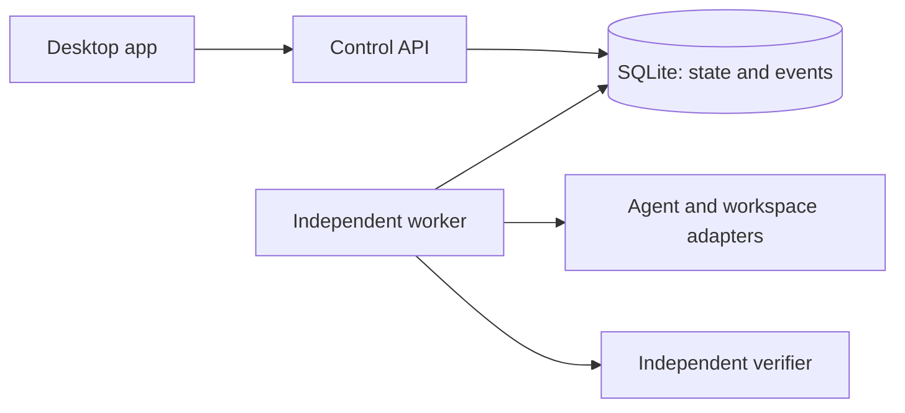

# Local development reference

Start with the [desktop quick start](../README.md#quick-start).

## Headless demo and desktop packaging

`npm run demo` starts real API and worker processes, submits a simulated task,
kills the API in the middle of the run, starts a new API and reads the same
verified history back. It leaves its database and artifact in a printed
`.data/demo-<id>` directory.

To build a self-contained macOS Apple Silicon app:

```sh
npm run desktop:smoke     # drives the real app; needs a macOS GUI session
npm run desktop:package
open release/Argent-darwin-arm64/Argent.app
```

Packaging produces `release/Argent-0.0.1-macos-arm64.zip` plus a `.sha256`
checksum. The app bundles its own runtime. It is **unsigned and not notarized**:
a local preview, not a public release. Windows, Linux and Intel Mac builds have
not been built or tested.

## Inspect a draft publication

Open the workspace menu and choose **Draft publication status** to read the
saved outcome. A verified draft lists its GitHub URL, source and base branches,
and the exact commits reviewed for publication. If a push or draft creation
needs attention, inspect those refs and the pull requests on GitHub before
taking further action. Opening the status does not repeat publication.

## How it works



The API records a run and its first event in one transaction. The worker claims
it atomically under a fenced lease, writes logs and completes a local run only
after independently recording its worktree state. That record is not a test
result. Simulated runs require an artifact integrity check. API requests never
own a running task. The desktop app
starts or reconnects to a detached local service that hosts the API and worker;
its renderer is sandboxed and never sees credentials. See
[ARCHITECTURE.md](../ARCHITECTURE.md) for the state machine, trust boundaries and
the planned cloud design.

| Layer          | Technology                                                    |
| -------------- | ------------------------------------------------------------- |
| Runtime        | Node.js 22.19.x, strict TypeScript, ESM                       |
| Desktop        | Electron 45.2.3 with a sandboxed renderer and a narrow bridge |
| Persistence    | Built-in `node:sqlite`, WAL, full synchronous commits         |
| Tests          | Node test runner, real multi-process crash/reconnect tests    |
| Planned cloud  | PostgreSQL plus an isolated workspace provider (E2B is first) |
| Planned agents | Official agent CLIs; Claude Code first, then Codex            |

`node:sqlite` is experimental in the tested Node release. The current engine is
built for a single trusted host on loopback, not for multi-tenant production.

## Configuration

**Desktop:** nothing to configure. Argent creates a private local service
credential and stores its data in `~/Library/Application Support/Argent/`. Set
`ARGENT_DESKTOP_DATA_DIR` to use an isolated data directory for development.

**Standalone API and worker (optional):** copy `.env.example` to `.env`, set a
unique token of at least 32 characters, and use the same `PLATFORM_DATA_DIR` for
both processes. Generate a token with:

```sh
node -e 'console.log(require("node:crypto").randomBytes(32).toString("hex"))'
```

Then build once and run each process in its own terminal:

```sh
npm run build
npm run start:api      # terminal 1
npm run start:worker   # terminal 2
```

The demo uses its own disposable token; never reuse it for a real deployment.

## Local API

The desktop's local service has configuration review and approval endpoints,
used by the desktop's Commands dialog; see the
[service acceptance contract](specs/0013-local-mvp.md#configuration-approval-service-acceptance-in-development).
Configuration approval alone does not run commands or verify an agent's changes.

The standalone API listens on loopback, on port 4310 by default. Set
`PLATFORM_PORT` to choose a different port. The desktop service selects an
available loopback port. Both require `Authorization: Bearer <token>` on
every request.

| Method | Route                                       | Input / behavior                                                                                                                                                |
| ------ | ------------------------------------------- | --------------------------------------------------------------------------------------------------------------------------------------------------------------- |
| GET    | `/health`                                   | Authenticated status information.                                                                                                                               |
| POST   | `/workspaces`                               | `{"repository":"https://github.com/owner/repo"}`; metadata only.                                                                                                |
| POST   | `/workspaces` (desktop service only)        | `{"source":"local","path":"/absolute/repo"}`; creates a branch and worktree.                                                                                    |
| GET    | `/workspaces?limit=50&before=<id>`          | Keyset-paginated workspace list.                                                                                                                                |
| GET    | `/workspaces/:id/runs?limit=50&before=<id>` | Keyset-paginated task history.                                                                                                                                  |
| GET    | `/workspaces/:id`                           | Read persisted workspace state.                                                                                                                                 |
| POST   | `/workspaces/:id/stop` or `/start`          | Preserve identity and files; refuse active or uncertain work.                                                                                                   |
| POST   | `/runs`                                     | `{"workspaceId":"…","task":"…","maxRuntimeMs":30000}`; requires `Idempotency-Key`. Local runs also take `"permissionMode":"edits"` or `"full"`.                 |
| GET    | `/runs/:id`                                 | Status and limits; the worker's fencing token is never returned.                                                                                                |
| GET    | `/runs/:id/events?after=0&limit=100`        | Ordered events and `nextCursor`; persist the cursor to reconnect.                                                                                               |
| POST   | `/runs/:id/cancel`                          | Persist cancellation; the worker acknowledges it cooperatively.                                                                                                 |
| GET    | `/runs/:id/artifact`                        | The artifact, after checking its committed SHA-256.                                                                                                             |
| POST   | `/runs/:id/resolve`                         | `{"note":"…"}`; audited abandonment of an uncertain simulated run.                                                                                              |
| POST   | `/runs/:id/reconcile-agent`                 | In development for the desktop service. Check the recorded group after a same-boot service restart. An absent group closes the interrupted agent run as failed. |

Repeating a submission with the same key and payload returns the original run; a
changed payload returns 409. Simulated runtime is bounded to 100–300,000 ms (default 30 s);
local runs to 1 s–2 h (default 30 min) and 2,000 log events.
A simulated run can emit at most 100 log events of up to 2,048 characters each, and request
bodies are capped at 16 KiB. The desktop service also exposes an authenticated
`/service/stop`, which standalone mode does not enable.

[First-run guidance in development](specs/0013-local-mvp.md#desktop-cli-readiness-before-submission-in-development)
checks for a missing CLI, an unsupported version and a missing sign-in before
the desktop accepts a new local task. The developer can correct the issue in
Terminal and resend the draft.

## Offline history export and restore

`npm run continuity -- help` lists the export, inspect, restore, list and show
commands. Export reads one simulation workspace from a consistent read-only
snapshot. Real local workspaces are rejected: export of Claude Code transcripts
and Git changes is planned.
Metadata is exported by default; task and log text and simulated artifacts need
`--include-text`. Credentials, leases and arbitrary files are never exported.
Text is not sanitized, so review it for secrets before sharing a bundle.

Restore writes a separate, read-only history database with no execution queue.
Imported in-progress or uncertain work is shown as `needs_attention`, and imported
checks never become trusted evidence. See
[spec 0012](specs/0012-portable-history.md#using-the-offline-cli) for the
exact commands, format and limits.

## Read-only GitHub pilot

```sh
npm run github:pilot -- --config /absolute/private/github-pilot.json
```

This opt-in command signs a GitHub App user in through GitHub's device flow,
checks the expected user, App installation, repository and read-only permissions,
and reads the exact branch SHA. It writes a redacted receipt next to the config.
The config and signing key must be regular files you own with `600` permissions
inside `700` directories. User and refresh tokens are never saved, and no host
credentials are discovered.

The pilot does not mint installation tokens, clone code or connect to the desktop
app. See [spec 0011](specs/0011-github-device-pilot.md) for the config format
and [spec 0010](specs/0010-live-repository-pilot-gates.md) for the gates
before live repository access.

## Development

| Script                    | Purpose                                                       |
| ------------------------- | ------------------------------------------------------------- |
| `npm run build`           | Compile source, tests and scripts into `dist/`.               |
| `npm run typecheck`       | Strict type checks without output.                            |
| `npm run format`          | Apply Prettier.                                               |
| `npm run format:check`    | Check formatting without edits.                               |
| `npm test`                | Build and run all unit and process tests.                     |
| `npm run check`           | Typecheck, formatting and all tests.                          |
| `npm run start:api`       | Run the built loopback API.                                   |
| `npm run start:worker`    | Run the built independent worker.                             |
| `npm run demo`            | Build and demonstrate API restart and reconnection.           |
| `npm run desktop`         | Build and launch the desktop app.                             |
| `npm run desktop:smoke`   | Drive the real Electron app and capture a screenshot.         |
| `npm run desktop:package` | Build a self-contained macOS arm64 app with a zip and digest. |
| `npm run site:preview`    | Serve the static download preview with local build artifacts. |
| `npm run continuity`      | Offline simulation-history export and read-only restore CLI.  |
| `npm run github:pilot`    | Opt-in device sign-in and read-only repository preflight.     |

Tests use temporary on-disk databases and real child processes: they kill API and
worker processes, race claims and check the durable history. They need permission
to listen on loopback and spawn processes, and they call no billable API. Test
files run serially so process startup on a busy machine doesn't eat into short
test leases. `desktop:smoke` needs a macOS GUI session and checks that the
renderer has no Node access and that the service survives the app exiting.

### Project layout

| Path           | Contents                                                               |
| -------------- | ---------------------------------------------------------------------- |
| `src/`         | API, durable store, worker, adapters, continuity and GitHub pilot code |
| `src/desktop/` | Electron main process, preload bridge and detached local service       |
| `ui/`          | The credential-free desktop renderer                                   |
| `tests/`       | Unit and multi-process integration tests                               |
| `scripts/`     | Demo, packaging, smoke, continuity and pilot entry points              |
| `website/`     | The landing page (Next.js) and the static download preview             |
| `docs/`        | Acceptance specs, milestone reports, research and decisions            |
